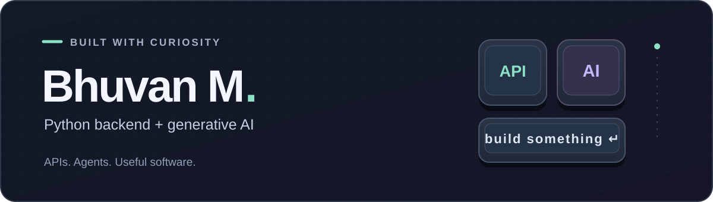

  

  <a href="https://bhuvan-portfolio-five.vercel.app"><strong>Portfolio</strong></a>
  &nbsp; · &nbsp;
  <a href="https://github.com/BhuvanM17?tab=repositories"><strong>Explore my code</strong></a>

## Hey, I'm Bhuvan 👋

I build Python APIs and AI applications, with a focus on useful workflows and clear backend design.

My projects explore document retrieval, AI agents, structured data workflows, and background text processing.

## My toolkit

  
   
  

  Python · FastAPI · Flask · Java · JavaScript · React · MySQL · SQLite 
  Git · GitHub · GitLab · AWS · Firebase · Postman · VS Code · Vercel

**AI workflows:** LangChain · LangGraph · Gemini · RAG · embeddings · ChromaDB  
**Data basics:** pandas · NumPy · scikit-learn

## Selected work

| Project | What it's about |
| :--- | :--- |
| **[InterviewGraph](https://github.com/BhuvanM17/interviewgraph)** | Interview practice with LangGraph, LangChain, FastAPI, and SQLite. Includes demo keyword scoring and optional Gemini integration. |
| **[Weekend Payana ↗](https://www.weekendpayana.com)** | Trek discovery and weekend travel booking website. |
| **[AI TaskHub](https://github.com/BhuvanM17/ai-taskhub)** | A FastAPI job API exploring database-backed dispatch, Redis workers, idempotency, and an optional LLM adapter. |
| **[RetrievalBench](https://github.com/BhuvanM17/retrievalbench)** | Offline retrieval evaluation for RAG, with Recall@K, MRR, nDCG, and a BM25 baseline. |
| **[DOC RAG](https://github.com/BhuvanM17/DOC-RAG)** | Document question answering with FastAPI, Gemini, Pinecone, and React. |
| **[DailyOps Agent](https://github.com/BhuvanM17/personal_assistant_using_langgraph)** | LangGraph workflows with tools, persistent memory, and approval steps. |

More experiments: **[AI Invoice Assistant](https://github.com/BhuvanM17/AI-Invoice-Assistant-Pro)** · **[GridQuest](https://github.com/BhuvanM17/gridquest-python)**

## What I'm working toward

Stronger Python backends for AI applications: clearer APIs, reliable background jobs, access control, and better error handling. I like understanding the tradeoffs behind a working demo.

---

Explore the work. **[Visit my portfolio.](https://bhuvan-portfolio-five.vercel.app)**

