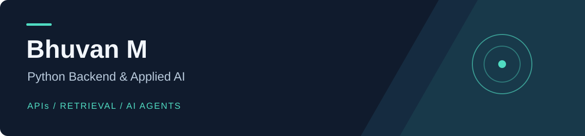

# Hi, I'm Bhuvan

I build Python APIs and AI applications, with a focus on useful workflows and clear backend design.

My public projects explore document retrieval, AI agents, structured data workflows, and background text processing.

**Focus: AI engineering, generative AI, and Python backend development.**

## What I work with

| Area | Tools and concepts |
|---|---|
| Python backend | Python, FastAPI, REST APIs, SQL, Pydantic, authentication |
| Applied AI | LLM integration, prompt engineering, RAG, embeddings |
| Agent workflows | LangChain, LangGraph, tool calling |
| Data and development | ChromaDB, MySQL, SQLite, Git, AWS |

## Selected projects

| Project | Focus |
|---|---|
| **[AI TaskHub](https://github.com/BhuvanM17/ai-taskhub)** | FastAPI job API with database-backed dispatch, Redis workers, idempotency, and an optional LLM adapter. |
| **[DOC RAG](https://github.com/BhuvanM17/DOC-RAG)** | Document question answering with FastAPI, Gemini, Pinecone, and a React interface. |
| **[DailyOps Agent](https://github.com/BhuvanM17/personal_assistant_using_langgraph)** | LangGraph workflows with tools, persistent memory, and approval steps. |
| **[AI Invoice Assistant](https://github.com/BhuvanM17/AI-Invoice-Assistant-Pro)** | Conversational invoice workflows, structured data validation, and PDF generation. |

## Current focus

Building stronger Python backends around AI: reliable job processing, access control, tests, and practical error handling. I care about understanding the tradeoffs as much as getting the demo working.

[Browse my repositories](https://github.com/BhuvanM17?tab=repositories) · [View my portfolio source](https://github.com/BhuvanM17/bhuvan-portfolio)
